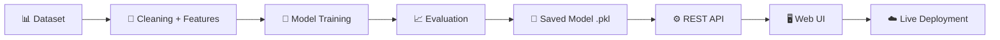
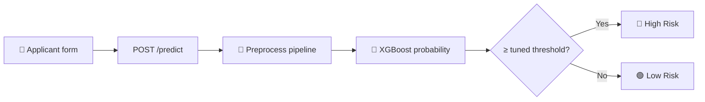
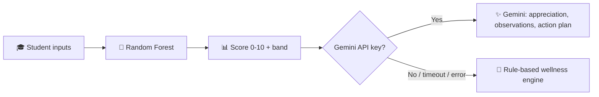
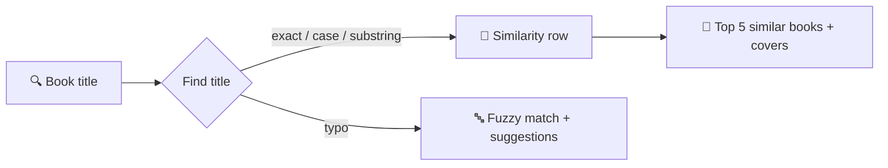
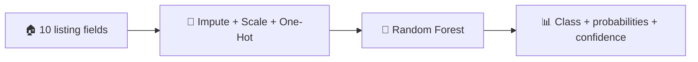

<div align="center">

# 🚀 Machine Learning Projects Portfolio

### Six end-to-end ML applications: data → model → API → live web app

**Built by Masum Ganvir** · [GitHub @masumganvir](https://github.com/masumganvir)


</div>

---

## 📌 About This Portfolio

Each project covers the full machine learning lifecycle rather than just a notebook:

1. 🗂️ **Data**: collect and understand a real-world dataset
2. 🧹 **Preprocessing**: clean data and engineer features
3. 🧠 **Modelling**: choose, train and evaluate a model
4. 💾 **Packaging**: save the trained model/pipeline (`.pkl`)
5. ⚙️ **Serving**: expose it through a REST API (FastAPI / Flask)
6. 🖥️ **Interface**: a custom web UI for non-technical users
7. ☁️ **Deployment**: hosted so anyone can try it



## 🗂️ Projects at a Glance

| # | Project | ML Task | Model | 🔗 Repo | 🌐 Live |
|---|---------|---------|-------|---------|---------|
| 1 | 📈 [Stock Price Prediction](#1--stock-price-prediction-system) | Regression (time-series features) | Gradient Boosting + 4 others | [Repo](https://github.com/masumganvir/stock_prediction_system) | [Open](https://stock-prediction-system-application-1.streamlit.app/) |
| 2 | 💳 [Credit Risk Assessment](#2--credit-risk-assessment-credit-ledger) | Binary classification | XGBoost + SHAP | [Repo](https://github.com/masumganvir/Credit_risk_prediction-system-) | [Open](https://credit-risk-prediction-system-3.onrender.com) |
| 3 | 🧠 [Mental Health Predictor](#3--mental-health-signal--ai-wellness-companion) | Regression + GenAI advice | Random Forest + Gemini | [Repo](https://github.com/masumganvir/Mental_health_prediction_system) | [Open](https://mental-health-prediction-system-x7ev.onrender.com) |
| 4 | 🏏 [IPL Win Probability](#4--ipl-win-probability-predictor) | Binary classification | Logistic Regression | [Repo](https://github.com/masumganvir/IPL_winning_match_team_system) | Run locally |
| 5 | 📚 [Book Recommender](#5--book-recommender-system-bookverse-ai) | Recommendation | Item-based Collaborative Filtering | [Repo](https://github.com/masumganvir/book_recommendation_system) | [Deploy](https://render.com/deploy?repo=https%3A%2F%2Fgithub.com%2Fmasumganvir%2Fbook_recommendation_system) |
| 6 | 🏙️ [NYC Airbnb Room Type](#6--nyc-airbnb-room-type-predictor) | Multi-class classification | Random Forest pipeline | [Repo](https://github.com/masumganvir/House-availability-preditions) | [Open](https://house-availability-preditions-2347.onrender.com/) |

> ⏳ Free-tier hosting sleeps when idle, so the first load may take 30–60 seconds.

## 🧰 Skills Demonstrated

| Area | What I used |
|------|-------------|
| 🧪 ML & Statistics | Regression, classification, ensembles, boosting, collaborative filtering, threshold tuning, model explainability (SHAP) |
| 🛠️ Feature engineering | Technical indicators, run-rate and match-state features, categorical encoding, scaling, imputation |
| 🧱 ML engineering | scikit-learn `Pipeline`/`ColumnTransformer`, model serialization with pickle/joblib |
| ⚙️ Backend | FastAPI, Flask, Pydantic validation, CORS, health checks, Swagger docs |
| 🖥️ Frontend | HTML5, CSS3 (glassmorphism, animations), vanilla JavaScript, Chart.js, Streamlit |
| 🤖 GenAI | Gemini API integration with graceful rule-based fallback |
| ☁️ DevOps | Render deployment, `render.yaml`, Gunicorn/Uvicorn, environment variables |

---

# 1. 📈 Stock Price Prediction System

[](https://github.com/masumganvir/stock_prediction_system) [](https://stock-prediction-system-application-1.streamlit.app/)

### 🎯 Problem
Investors and students want a quick, data-driven view of where a stock price may go. This app forecasts the closing price for any ticker 7–180 days ahead and compares several models side by side.

### 📊 Dataset
| Item | Detail |
|------|--------|
| **Source** | Yahoo Finance, fetched live through the `yfinance` library |
| **Type** | Daily OHLCV market data (Open, High, Low, Close, Volume), numeric time series |
| **Window** | Last 2 years of daily bars (default), auto-adjusted prices |
| **Coverage** | Any Yahoo-supported ticker: US stocks (`AAPL`), Indian stocks (`RELIANCE.NS`), crypto (`BTC-USD`) |

Because data is downloaded at request time, there is no static CSV and predictions always use the latest market data.

### 🧹 Feature Engineering (19 indicators)
Raw prices alone carry little signal, so I converted them into indicators that traders actually use:

| Group | Features | Why |
|-------|----------|-----|
| 📉 Trend | MA 5/10/20/50, EMA 12/26 | Smooth noise and show direction |
| ⚡ Momentum | MACD, MACD signal, RSI(14), 5-day momentum, 10-day ROC | Show strength and speed of moves |
| 🌊 Volatility | Bollinger upper/lower/width, 20-day volatility, distance from MA20 | Capture risk and over-extension |
| 📦 Volume | Volume, volume ratio vs 10-day average | Confirms price moves |
| 💲 Price | Adjusted close | Base level |

**Target:** the price N days in the future (`Close.shift(-N)`). Features are standardised before training.

### 🧠 Models Used and Why
| Model | Why I included it |
|-------|-------------------|
| **Linear Regression** | Simple, interpretable baseline to beat |
| **Ridge Regression** | Adds L2 regularisation; indicators are highly correlated (MA/EMA), which destabilises plain linear regression |
| **Random Forest** (200 trees, depth 8) | Captures non-linear relationships; robust to outliers; less prone to overfitting via bagging |
| **Gradient Boosting** (300 trees, lr 0.05, depth 4) | Builds trees sequentially to correct previous errors; typically the strongest on tabular data |
| **Voting Ensemble** (GB + RF + Ridge) | Averages different model families to reduce variance |

All five train on every request and the app selects the **best model by R²**.

### 🏆 Results (AAPL)
| Model | MAE ($) | RMSE ($) | R² |
|-------|--------:|---------:|---:|
| 🥇 Gradient Boosting | 3.26 | 4.50 | **0.974** |
| 🥈 Random Forest | 4.00 | 5.53 | 0.961 |
| 🥉 Voting Ensemble | 5.16 | 6.81 | 0.941 |
| Linear Regression | 8.17 | 11.31 | 0.838 |
| Ridge Regression | 9.17 | 11.97 | 0.818 |

Boosting outperforming the linear baseline by a wide margin confirms that price behaviour has non-linear structure that tree ensembles capture.

### 🖥️ App Features
🔎 Ticker search · 🎚️ forecast slider (7–180 days) · 📊 forecast, actual-vs-predicted and residual charts · 📉 Bollinger/MACD/RSI overlays · 📥 CSV export · 🖨️ printable report

### 🏗️ Architecture & Tech
Streamlit app (`streamlit_app.py`) and a Flask + Chart.js dashboard share one prediction engine (`predictor.py`). **Stack:** Python, scikit-learn, pandas, NumPy, yfinance, Streamlit, Flask, Chart.js.

### ▶️ Run Locally
```bash
git clone https://github.com/masumganvir/stock_prediction_system.git
cd stock_prediction_system && pip install -r requirements.txt
streamlit run streamlit_app.py            # http://localhost:8501
```

### ⚠️ Limitations & Next Steps
- Uses a random train/test split, which tends to give optimistic R² on time-series data. **Next:** walk-forward (chronological) validation.
- Future values are model extrapolations; uncertainty grows with horizon. **Next:** prediction intervals, LSTM/Prophet comparison.
- For education only, not financial advice.

---

# 2. 💳 Credit Risk Assessment (Credit Ledger)

[](https://github.com/masumganvir/Credit_risk_prediction-system-) [](https://credit-risk-prediction-system-3.onrender.com) [](https://credit-risk-prediction-system-3.onrender.com/docs)

### 🎯 Problem
Lenders lose money when borrowers default. This app estimates the **probability that a loan applicant will default** so a reviewer can make a faster, more consistent decision.

### 📊 Dataset
| Item | Detail |
|------|--------|
| **File** | `credit_risk_dataset.csv` (in the repo) |
| **Source** | A public credit-risk dataset of the kind published on Kaggle (applicant, loan and credit-bureau fields) |
| **Type** | Tabular, mixed numeric and categorical |
| **Target** | Loan default (1 = defaulted, 0 = repaid), an imbalanced binary label |

**Features:** age, income, home ownership, employment length, loan intent, loan grade, loan amount, interest rate, loan-to-income ratio, prior default on file, credit-history length.

### 🧠 Model Used and Why
| Choice | Reason |
|--------|--------|
| **XGBoost** classifier | Gradient-boosted trees handle mixed tabular features, non-linear interactions and missing values well, and are a standard for credit scoring |
| **Pipeline with preprocessing** | Encoding/scaling travel with the model, so the API accepts raw form values |
| **Tuned decision threshold** (`best_threshold.pkl`) | Defaults are rarely balanced; the cut-off is optimised instead of fixed at 0.5, so the business trade-off between missed defaults and wrongly rejected good customers is controlled |
| **SHAP** | Credit decisions must be explainable; SHAP quantifies each feature's contribution to a prediction |



### 🔌 API
`POST /predict` returns:
```json
{"default_probability": 0.0253, "default_prediction": 0, "threshold": 0.9996, "Result": "Low Risk"}
```
Interactive docs: [`/docs`](https://credit-risk-prediction-system-3.onrender.com/docs). The model loads once at start-up (FastAPI lifespan); CORS is enabled so the UI can be hosted separately.

### 🖥️ Interface
Dark glassmorphism UI with glowing animations, a dynamic risk gauge and a stamped **LOW RISK / HIGH RISK** verdict.

### 🏗️ Tech
Python, FastAPI, Pydantic v2, XGBoost, SHAP, scikit-learn, pandas, joblib, HTML/CSS/JS. Deployed on Render.

### ▶️ Run Locally
```bash
git clone https://github.com/masumganvir/Credit_risk_prediction-system-.git
cd Credit_risk_prediction-system- && pip install -r requirements.txt
python -m uvicorn main:app --reload       # http://127.0.0.1:8000
```

### ⚠️ Limitations & Next Steps
- The stored threshold is very high (~0.9996), so it should be re-validated against precision/recall on a held-out set. **Next:** show the precision-recall curve and cost-based threshold selection.
- No fairness analysis yet. **Next:** check bias across age and home-ownership groups.
- Estimates only, not a real lending decision.

---

# 3. 🧠 Mental Health Signal & AI Wellness Companion

[](https://github.com/masumganvir/Mental_health_prediction_system) [](https://mental-health-prediction-system-x7ev.onrender.com)

### 🎯 Problem
Students often do not notice how sleep, screen time, stress and study load add up. This app predicts a **wellness score from 0 to 10** and gives personalised, actionable advice.

### 📊 Dataset
| Item | Detail |
|------|--------|
| **File** | `Student Social Media And Mental Health Impact.csv` |
| **Source** | A public student survey dataset on social-media use and mental health (Kaggle-style survey data) |
| **Type** | Tabular survey data, mixed numeric and categorical |
| **Target** | Mental health score (numeric, 0–10) |

**Features:** age, gender, country (also grouped into top countries + "Other" to avoid sparse categories), academic level, study hours, most-used platform, purpose of use, daily screen time, daily phone unlocks, sleep hours, physical activity hours, perceived stress level.

### 🧠 Model Used and Why
| Choice | Reason |
|--------|--------|
| **Random Forest Regressor** | The target is a continuous score; forests handle mixed feature types, non-linear effects (e.g., sleep × stress) and need little tuning |
| **Country grouping** | Reduces high-cardinality noise for rare countries |
| **Output clamped to 0–10** | Keeps predictions in a valid range |

### ✨ AI Insights Layer (GenAI)

- **Gemini** (`gemini-2.0-flash`, falling back to `gemini-1.5-flash`) returns structured JSON: appreciation, summary, key observations, 3–4 action items and encouragement.
- **Fallback engine** analyses sleep, screen time, unlocks, activity and stress with fixed rules, so the app **still works with no API key or when the API is down**.

### 🎯 Score Bands
| Score | Status |
|-------|--------|
| 🟢 ≥ 7.5 | Thriving & high wellness |
| 🟡 5.5 – 7.5 | Balanced baseline |
| 🟠 4.0 – 5.5 | Mild strain & fatigue |
| 🔴 < 4.0 | High stress & burnout risk |

### 🔌 API
`POST /predict` (validated by Pydantic: age 10–100, hours 0–24, fixed category lists) · `GET /api/status` (reports whether Gemini is configured).

### 🏗️ Tech
Python, FastAPI, Uvicorn, scikit-learn, pandas, joblib, httpx, python-dotenv, Gemini API, vanilla JS.

### ▶️ Run Locally
```bash
git clone https://github.com/masumganvir/Mental_health_prediction_system.git
cd Mental_health_prediction_system && pip install -r requirements.txt
echo "GEMINI_API_KEY=your_key" > .env        # optional
python -m uvicorn main:app --port 2200 --reload
```

### ⚠️ Limitations & Next Steps
- Based on self-reported survey data; **not a clinical or diagnostic tool**. Please seek professional help if you are struggling.
- **Next:** report cross-validated error (MAE/R²) in the README and test on additional populations.

---

# 4. 🏏 IPL Win Probability Predictor

[](https://github.com/masumganvir/IPL_winning_match_team_system) 

### 🎯 Problem
During a run chase, fans and analysts ask "what are the chances right now?" This app returns a live **win probability for the chasing team** from the current match situation.

### 📊 Dataset
| Item | Detail |
|------|--------|
| **Files** | `matches.csv` (one row per match) and `deliveries.csv` (one row per ball) |
| **Source** | Public IPL historical datasets (Kaggle-style match and ball-by-ball data) |
| **Type** | Tabular sports data: match metadata plus ball-by-ball events |
| **Target** | Whether the chasing (batting) team won |

### 🧹 Data Preparation
1. Computed the **first-innings total** from deliveries to define the target.
2. Standardised franchise names (Delhi Daredevils → Delhi Capitals, Deccan Chargers → Sunrisers Hyderabad) and kept the 8 current teams.
3. Removed Duckworth–Lewis (rain-affected) matches, since their targets are not comparable.
4. Built **match-state features for every ball of the second innings**:

| Feature | Meaning |
|---------|---------|
| `runs_left`, `balls_left`, `wickets` | Resources remaining |
| `total_runs_x` (target) | Score to beat |
| `crr` / `rrr` | Current and required run rate |
| `batting_team`, `bowling_team`, `city` | Context |

### 🧠 Model Used and Why
| Choice | Reason |
|--------|--------|
| **Logistic Regression** | Output is a true probability, which is exactly what the app shows; fast, stable and interpretable |
| **One-hot encoding** of team and city | Converts categories to numbers inside a `Pipeline` so training and serving use identical preprocessing |
| **80/20 split** | Held-out test set for evaluation |

**Result:** about **80.45% accuracy** on the test set (as recorded in the project).

### ✨ App Features
🎯 live runs needed, balls left, CRR and RRR · 🎨 team-themed stadium UI · 🧭 radial gauges and tug-of-war momentum bar · 📈 over-by-over win-probability projection · ⚡ presets for famous matches · three interfaces: Flask web app, Streamlit app and a Python/CLI class (`IPLPredictor`).

### 🔌 API
`GET /api/health` · `POST /api/predict` · `POST /api/progression` (probability curve for overs 1–20).

### 🏗️ Tech
Python, Flask, Gunicorn, Streamlit, scikit-learn, pandas, SVG/CSS animations. Render config included (`render.yaml`).

### ▶️ Run Locally
```bash
git clone https://github.com/masumganvir/IPL_winning_match_team_system.git
cd IPL_winning_match_team_system && pip install -r requirements.txt
python app.py                     # http://127.0.0.1:5000
# retrain: python train_model.py
```

### ⚠️ Limitations & Next Steps
- Second-innings only; ignores which batters are at the crease. **Next:** player-level features and a gradient-boosting comparison.
- Statistical estimate, not betting advice.

---

# 5. 📚 Book Recommender System (BookVerse AI)

[](https://github.com/masumganvir/book_recommendation_system) [](https://render.com/deploy?repo=https%3A%2F%2Fgithub.com%2Fmasumganvir%2Fbook_recommendation_system)

### 🎯 Problem
Readers face thousands of choices. This app recommends **five books similar to one they already like** and showcases the most popular books.

### 📊 Dataset
| Item | Detail |
|------|--------|
| **Source** | A public book-ratings dataset in the Book-Crossing style (books, users, ratings) |
| **Type** | Three linked tables: book metadata (title, author, year, publisher, cover URL), users, and user–book ratings |
| **Scale** | 270,000+ books in the catalogue; **706 books** qualify for the collaborative model |

### 🧹 Method
1. **Popularity ranking:** per book, count ratings and average rating; keep books with enough votes, then rank the **Top 50** (saved as `popular.pkl`).
2. **Filter for reliability:** keep active users and well-rated books so similarity is statistically meaningful (leaves the 706-title pivot table `pt.pkl`).
3. **Pivot table:** book titles × users ratings matrix.
4. **Item–item similarity matrix** (`similarity_scores.pkl`) precomputed once so recommendations are instant.

### 🧠 Why Collaborative Filtering
| Reason | Detail |
|--------|--------|
| No content needed | Learns from rating behaviour: "people who liked X also liked Y" |
| Fast at serving time | Similarity is precomputed; lookup is a sort over one row |
| Interpretable | Each result has a similarity score and percentage |



### ⚡ Engineering Highlights
- 🔎 4-step title matching: exact → case-insensitive → substring → fuzzy (`difflib`)
- 🚀 In-memory metadata cache for constant-time lookups
- 🧠 Frees the large DataFrame after start-up to fit a **512 MB** free-tier memory limit
- 🔒 Forces HTTPS cover images; placeholder fallback

### 🔌 Routes
`/` home · `/recommend` studio · `/api/popular` · `/api/titles` · `/api/search?q=` · `/api/recommend` (POST) · `/health`

### 🏗️ Tech
Python 3.11, Flask, NumPy, Pandas, Gunicorn, Jinja2, HTML/CSS/JS. Render blueprint included.

### ▶️ Run Locally
```bash
git clone https://github.com/masumganvir/book_recommendation_system.git
cd book_recommendation_system && pip install -r requirements.txt
python app.py                     # http://127.0.0.1:5000
```

### ⚠️ Limitations & Next Steps
- Cold start: books outside the 706 modelled titles cannot be recommended. **Next:** hybrid model adding content features (author, genre, text embeddings).

---

# 6. 🏙️ NYC Airbnb Room Type Predictor

[](https://github.com/masumganvir/House-availability-preditions) [](https://house-availability-preditions-2347.onrender.com/) [](https://house-availability-preditions-2347.onrender.com/docs) [](https://house-availability-preditions-2347.onrender.com/redoc)

### 🎯 Problem
Given a listing's location, price and activity, can we infer whether it is an **Entire home/apt**, **Private room** or **Shared room**? This is useful for catching mislabelled listings and for market analysis. (The repository is named *House-availability-preditions*, but the task is room-type classification.)

### 📊 Dataset
| Item | Detail |
|------|--------|
| **Name** | New York City Airbnb Open Data |
| **Source** | Public Airbnb listing data for NYC (widely distributed on Kaggle, derived from Inside Airbnb) |
| **Size** | 48,895+ listings across Manhattan, Brooklyn, Queens, the Bronx and Staten Island |
| **Type** | Tabular, mixed numeric and categorical |
| **Target** | `room_type` (3 classes) |

### 🧠 Model Used and Why
| Stage | Choice | Reason |
|-------|--------|--------|
| 🔢 Numeric | Imputer → `StandardScaler` | Handles missing values and puts features on a common scale |
| 🔤 Categorical | Imputer → `OneHotEncoder(handle_unknown='ignore')` | Borough and neighbourhood become numeric; unseen neighbourhoods do not crash the API |
| 🌲 Classifier | **Random Forest** (tuned) | Handles non-linear patterns (price × location), mixed features and multi-class output, and returns class probabilities |

Everything lives in **one serialised pipeline** (`Model_Pipeline.pkl`), so the API accepts raw user inputs with no separate preprocessing code.



### 🔌 API
| Link | Purpose |
|------|---------|
| [🏠 /](https://house-availability-preditions-2347.onrender.com/) | Web UI |
| [🩺 /health](https://house-availability-preditions-2347.onrender.com/health) | Health check |
| [📖 /docs](https://house-availability-preditions-2347.onrender.com/docs) | Swagger UI |
| 🔮 `POST /predict` | Prediction |

Inputs are validated (latitude −90..90, price > 0, minimum nights 1–365, availability 0–365, and so on). Sample response:
```json
{"Predicted_room_type": "Entire home/apt", "confidence": 62.69,
 "Probabilities": {"Entire home/apt": 0.6269, "Private room": 0.3453, "Shared room": 0.0278}}
```

### 🖥️ Interface
Dark "cyber-skyline" UI with an animated particle canvas, 3D building visual, probability charts, one-click presets and an automatic backend-health monitor that retries while a sleeping server wakes.

### 🏗️ Tech
Python 3.12, FastAPI, Uvicorn, Pydantic, scikit-learn, pandas, joblib, HTML/CSS/JS. Deployed on Render.

### ▶️ Run Locally
```bash
git clone https://github.com/masumganvir/House-availability-preditions.git
cd House-availability-preditions && pip install -r requirements.txt
uvicorn main:app --reload --port 8000     # http://127.0.0.1:8000
```

### ⚠️ Limitations & Next Steps
- Shared rooms are rare in the data, so that class is hard to predict. **Next:** class-weighting/SMOTE and per-class precision/recall reporting.

---

## ⚙️ Common Setup
```bash
python -m venv venv && source venv/bin/activate      # Windows: .\venv\Scripts\activate
pip install -r requirements.txt
```

## ⚠️ Disclaimer
These are educational projects. Outputs are model estimates: not financial advice, not a lending decision, not a medical diagnosis and not betting guidance.

## 📬 Contact

<div align="center">

### 👨‍💻 **Masum Ganvir** · [github.com/masumganvir](https://github.com/masumganvir)

⭐ If you found these projects useful, please star the repositories!

</div>
